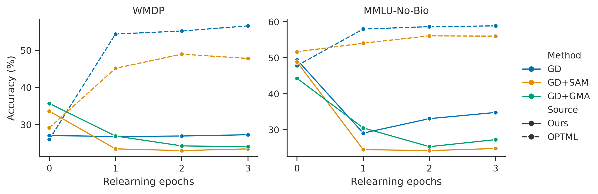

# Hyperparameter search

### Search space

| Method | Precision | LR | Retain coefficient | GMA coefficient | Configs |
|---|---|---|---|---|---:|
| GD | BF16 | 1, 2, 2.5, 2.75, 3, 5 | 1, 1.5, 2 | — | 18 |
| GD+SAM | BF16 | 1, 5 | 1, 1.5, 2 | — | 6 |
| GD+GMA | BF16 | 1 | 1, 1.5, 2 | 1, 2, 5 | 9 |
| GD+GMA | BF16 | 5 | 1 | 1, 2 | 2 |
| GD+GMA | BF16 | 3 | 1.5 | 0, 0.003, 0.01, 0.1 | 4 |
| GD+GMA | FP32 | 1 | 2 | 0, 0.1, 0.3, 0.5, 1 | 5 |
| GD+GMA | FP32 | 1 | 4 | 0, 1 | 2 |
| GD+GMA | FP32 | 2 | 2 | 1 | 1 |

- LR values are in units of **10⁻⁶**.
- SAM uses ρ = 0.01
- GMA uses finite-difference ε = 0.001 throughout.

### Seletion Criteria
Select the configuration with the lowest worst-case WMDP accuracy, subject to
a capability drop of no more than **15 percentage points** from the base model.

### Configs selected
- GD: LR 2.75e-6, retain 1.5 (BF16).
- GD+SAM: LR 5e-6, retain 1.5, ρ = 0.01 (BF16).
- GD+GMA: LR 2e-6, retain 2.0, GMA coefficient 1.0 (FP32).

### Attacks

Attacks used 20 documents and LR 1e-5, each starting from the same defended model

### Results

These results are archived under `artifacts/tamia/results-in-distribution/`.
Our original defence runs used ordered data, so all 20 attack documents were
included during defence. Base-model and OPTML evaluations are archived alongside
them; OPTML's defence-data overlap has not been verified.

