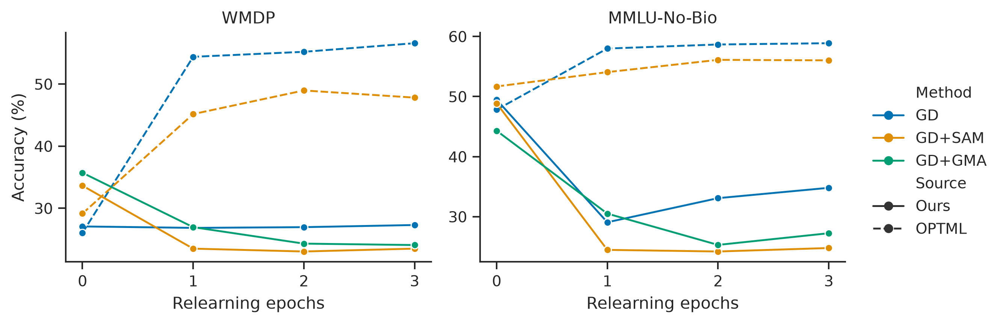

# Hyperparameter search

## W&B sweeps

The Bayesian GD+SAM sweep searches defence LR from 2.5e-6 to 5e-6 and retain
coefficient from 1.0 to 2.0, with ρ fixed at 0.01. It minimizes pre-attack WMDP
accuracy subject to pre-attack MMLU-No-Bio of at least 42.5873%. Ineligible trials
receive objective `1 + (minimum MMLU - observed MMLU)`; eligible trials use WMDP
accuracy. All accuracies are fractions, so ineligible trials rank worse.

From the example root, create a sweep and run up to 10 trials:

```bash
mkdir -p artifacts/tamia/logs
sbatch --partition=gpubase_bynode_b1 scripts/slurm/tamia/run_wandb_sweep.sbatch \
  configs/sweeps/z7b-wmdp-bio--unlearn-fft-gd-sam-rho1e-2.yml 10
```

The job prints its sweep ID. Pass that `entity/project/sweep-id` instead of the
YAML to continue the same search in another job. Passing the YAML creates a new
sweep each time. The agent launches `scripts/misc/run_unlearn_trial.py` using
the sampled HPs and existing defence config as CLI arguments. The evaluation
executable is passed with `--eval_accelerate`, resolved from each job's evaluation
environment by the sweep command. Each trial evaluates the defended
model; relearning attacks are separate.

Models and evaluations use `artifacts/tamia/{models,results}/<model-name>/sweeps/<run-id>/`.
The sweep run records final metrics and HPs in `lp-tamper-resistance-v2`; child
training runs have W&B disabled to avoid reusing the sweep run ID. Model weights
are removed after successful evaluation, while evaluation JSONs are kept.
Clear the defence and relearning prepared caches when switching to masked
padding labels; existing unmasked experiment results remain archived separately.

## In-distribution experiment

### Search space

| Method | Precision | LR | Retain coefficient | GMA coefficient | Configs |
|---|---|---|---|---|---:|
| GD | BF16 | 1, 2, 2.5, 2.75, 3, 5 | 1, 1.5, 2 | — | 18 |
| GD+SAM | BF16 | 1, 5 | 1, 1.5, 2 | — | 6 |
| GD+GMA | BF16 | 1 | 1, 1.5, 2 | 1, 2, 5 | 9 |
| GD+GMA | BF16 | 5 | 1 | 1, 2 | 2 |
| GD+GMA | BF16 | 3 | 1.5 | 0, 0.003, 0.01, 0.1 | 4 |
| GD+GMA | FP32 | 1 | 2 | 0, 0.1, 0.3, 0.5, 1 | 5 |
| GD+GMA | FP32 | 1 | 4 | 0, 1 | 2 |
| GD+GMA | FP32 | 2 | 2 | 1 | 1 |

- LR values are in units of **10⁻⁶**.
- SAM uses ρ = 0.01
- GMA uses finite-difference ε = 0.001 throughout.

### Seletion Criteria
Select the configuration with the lowest worst-case WMDP accuracy, subject to
a capability drop of no more than **15 percentage points** from the base model.

### Configs selected
- GD: LR 2.75e-6, retain 1.5 (BF16).
- GD+SAM: LR 5e-6, retain 1.5, ρ = 0.01 (BF16).
- GD+GMA: LR 2e-6, retain 2.0, GMA coefficient 1.0 (FP32).

### Attacks

Attacks used 20 documents and LR 1e-5, each starting from the same defended model

### Results

These results are archived under `artifacts/tamia/results-in-distribution/`.
Our original defence runs used ordered data, so all 20 attack documents were
included during defence. Base-model and OPTML evaluations are archived alongside
them; OPTML's defence-data overlap has not been verified.



## Out of distribution experiment

### Search space

| Method | Precision | LR | Retain coefficient | GMA coefficient | Configs |
|---|---|---|---|---|---:|
| GD | BF16 | 1, 2, 5 | 1, 1.5, 2 | — | 9 |
| GD+SAM | BF16 | 1, 2, 5 | 1, 1.5, 2 | — | 9 |
| NPO | BF16 | 1, 2, 5 | 1, 1.5, 2 | — | 9 |
| NPO+SAM | BF16 | 1, 2, 5 | 1, 1.5, 2 | — | 9 |
| GD+GMA | FP32 | 1, 2, 5 | 0.1 | 0, 1 | 6 |

- LR values are in units of **10⁻⁶**.
- SAM uses ρ = 0.01.
- NPO uses β = 0.0225; NPO+SAM uses β = 0.015.
- GMA uses finite-difference ε = 0.001; coefficient 0 is the FP32 GD control.
- All defences use 125 steps.

### Selection Criteria

Select the configuration with the lowest worst-case WMDP accuracy, using a soft
capability-drop target of **15 percentage points**, allowing drops up to
**16 percentage points** from the base model's pre-attack MMLU-No-Bio accuracy.
The base model scores 58.59%, so the minimum allowed score is 42.59%.
Worst-case WMDP includes the pre-attack evaluation and all three attacks.

### Configs selected

- GD: LR 5e-6, retain 2.0 (BF16; pre-attack MMLU 43.03%, a 15.56-point drop).
- GD+SAM: LR 5e-6, retain 1.5, ρ = 0.01 (BF16).
- NPO: LR 5e-6, retain 1.0, β = 0.0225 (BF16).
- NPO+SAM: LR 1e-6, retain 1.5, β = 0.015, ρ = 0.01 (BF16).
- GD+GMA: selection pending.

| Method | Pre-attack MMLU-No-Bio | Pre-attack WMDP | Worst-case WMDP |
|---|---:|---:|---:|
| NPO | 51.57% | 25.46% | 26.73% |
| NPO+SAM | 58.62% | 54.95% | 55.88% |

The selected NPO configuration loses 7.02 percentage points of pre-attack MMLU,
but post-attack MMLU falls to 24–28%, so its low post-attack WMDP coincides with
broad capability collapse. NPO+SAM provides little unlearning among the eligible
configurations; its configurations with low WMDP fail the capability constraint.

### Attacks

Attacks use 20 documents and LR 1e-5, with independent 1-, 2-, and 3-epoch runs,
each starting from the same defended model.

### Results

These results are archived under `artifacts/tamia/results-out-of-distribution/`. Forget and retain datasets
are shuffled independently before merging, using seed 3. The attack uses the
first 20 filtered forget documents; shuffling does not enforce disjoint defence
and attack sets.


